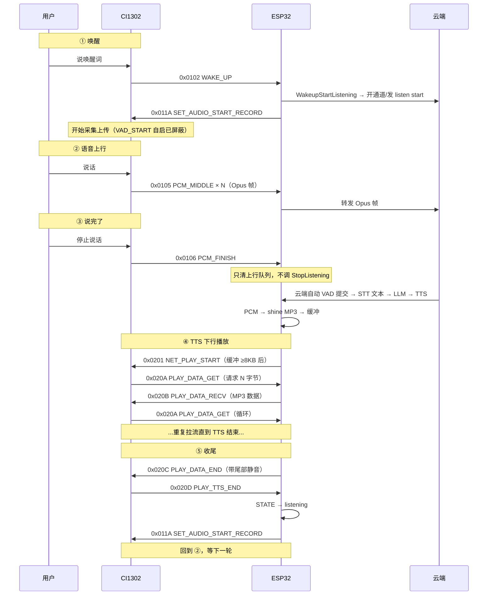
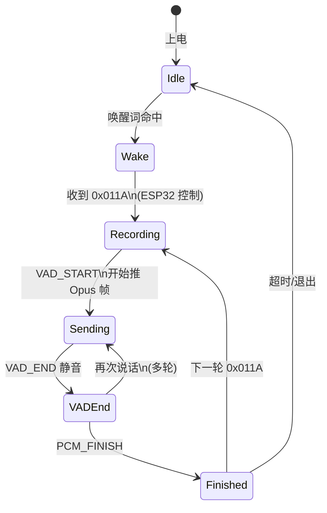
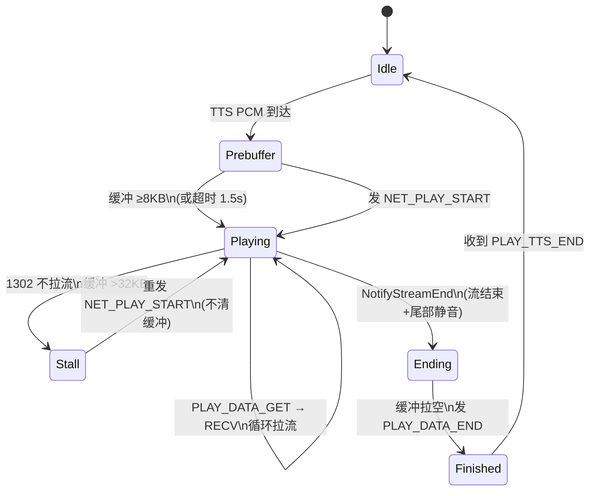
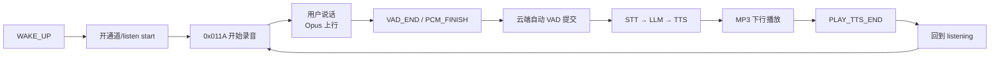

# CI1302 语音识别与 UART 协议流程

> 板型：YcscEsp32S3Es8311WgxlCat
> 通信：UART 921600 baud
> 上行：1302 直接吐 Opus 帧（ESP32 不再二次编码）
> 下行：ESP32 将云端 PCM 用 shine 编码为 MP3，1302 拉流播放

---

## 一、整体时序图

---

## 二、命令字一览

### ESP32 → CI1302（下行控制）

| 命令字 | 值 | 含义 |
|---|---|---|
| SET_AUDIO_START_RECORD | 0x011A | 强制开始录音上传 |
| SET_AUDIO_STOP_RECORD | 0x011B | 停止录音上传 |
| NET_PLAY_START | 0x0201 | 启动播放会话（1302 开始拉流） |
| NET_PLAY_STOP | 0x0204 | 立即停止播放（打断） |
| PLAY_DATA_RECV | 0x020B | 响应 1302 的 GET，携带 MP3 数据 |
| PLAY_DATA_END | 0x020C | 播放数据发完（带尾部数据） |

### CI1302 → ESP32（上行事件）

| 命令字 | 值 | 含义 |
|---|---|---|
| LOCAL_ASR_NOTIFY | 0x0101 | 本地命令词命中 |
| WAKE_UP | 0x0102 | 唤醒词检测到 |
| VAD_END | 0x0103 | 人声结束（静音检测） |
| PCM_MIDDLE | 0x0105 | Opus 上行帧（负载为 Opus 数据） |
| PCM_FINISH | 0x0106 | 本句音频上传完毕 |
| VAD_START | 0x0108 | 人声开始（原厂自启上传已屏蔽） |
| PLAY_DATA_GET | 0x020A | 请求播放数据（负载 u32 请求长度） |
| PLAY_TTS_END | 0x020D | 播放完成上报 |

---

## 三、上行状态机（CI1302 侧）

**关键点：**
- 唤醒后 1302 **不会自己开始上传**（原厂 `cias_aiot_vad_start_handle(VAD_START)` 已屏蔽），等 ESP32 发 `0x011A`。
- 录音期间 VAD_END 检测**必须保留**，否则 1302 一直上传不发 PCM_FINISH，云端等不到句子边界。

---

## 四、下行播放状态机（ESP32 侧）

**关键点：**
- 预缓冲 8KB 再发 NET_PLAY_START，防止起播丢字。
- 下行死锁时**不清空缓冲**，只重发 NET_PLAY_START 踢 1302。
- TTS 结束追加 1 秒静音尾巴，防止 1302 播放器缓冲吞尾字。

---

## 五、多轮对话循环

---

## 六、与 ES8311 的差异

| 方面 | ES8311（I2S） | CI1302（UART） |
|---|---|---|
| 唤醒检测 | ESP32 本地 AFE | 1302 外置芯片检测 |
| VAD | ESP32 本地 | 1302 外置芯片 |
| 上行编码 | ESP32 Opus 编码 | 1302 直接吐 Opus，ESP32 直通 |
| 下行播放 | ESP32 I2S DAC | ESP32 shine→MP3，1302 拉流播放 |
| 录音控制 | 无（I2S 常开） | 0x011A 开始 / 0x011B 停止 |
| 句子收尾 | ESP32 VAD 触发 stop | 云端自动 VAD 提交（PCM_FINISH 只清队列） |
