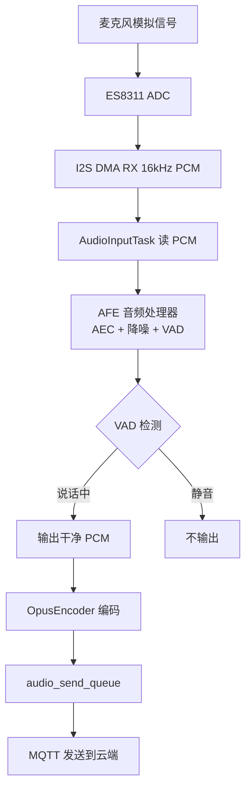
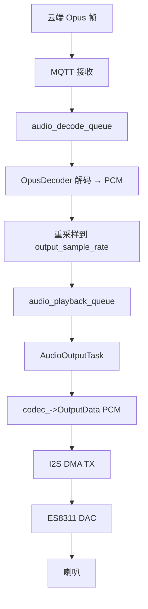
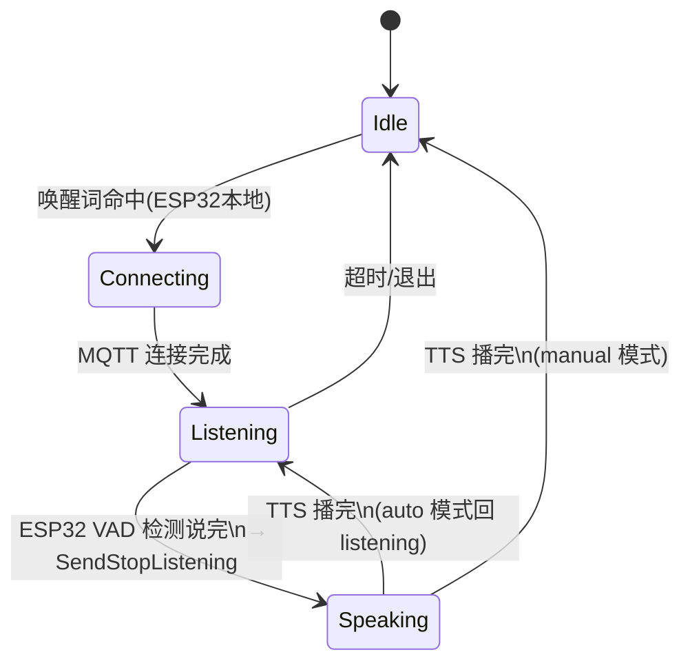
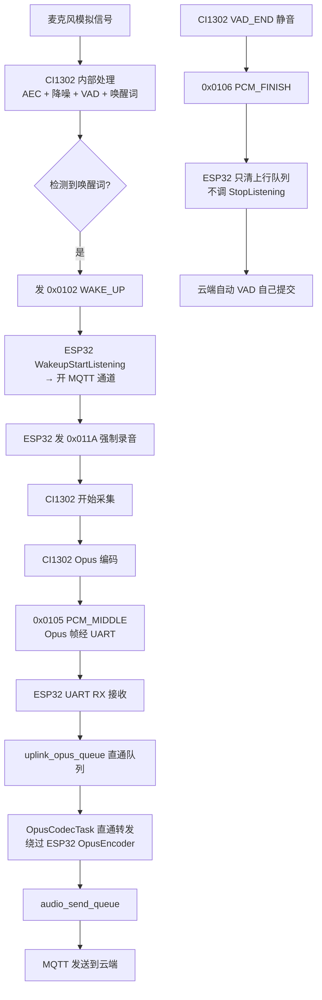
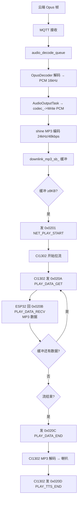
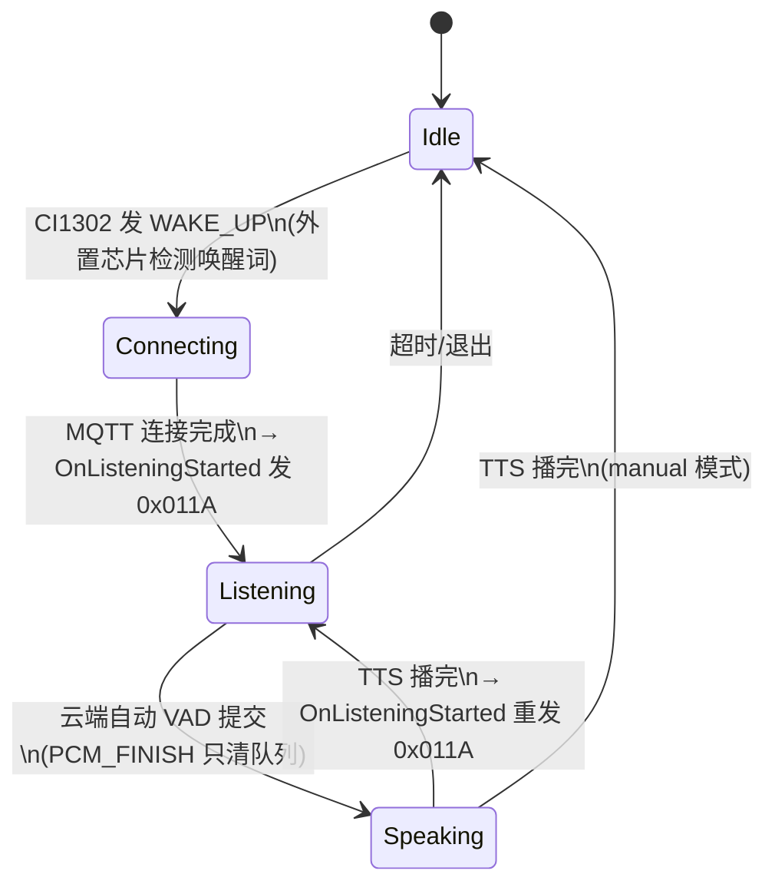

# ES8311 vs CI1302 音频架构与工作流程对比

> 板型：YcscEsp32S3Es8311WgxlCat
> ESP32：ESP32-S3
> 云端：MQTT 协议，Opus 音频帧

---

## 一、ES8311（I2S Codec）工作流程

### 1.1 硬件通路

```
麦克风 → ES8311 ADC → I2S_RX → ESP32
ESP32 → I2S_TX → ES8311 DAC → 喇叭
I2C → ES8311 寄存器控制（音量/采样率/PA 开关）
```

ES8311 只是一个**模拟 ADC/DAC**，所有音频处理（AEC/降噪/VAD/唤醒词/编码）都在 ESP32 上完成。

### 1.2 上行（录音→云端）



**关键点：**
- ESP32 的 AFE（Audio Front End）负责 AEC 回声消除、降噪、VAD。
- 唤醒词检测也在 ESP32 上（WakeWord 引擎喂同一路 PCM）。
- ESP32 自己做 Opus 编码后发到云端。
- VAD 检测到说完话 → `Application::StopListening()` → 发 `listen/stop` 给云端。

### 1.3 下行（云端→喇叭）



**关键点：**
- 云端 Opus → ESP32 OpusDecoder → PCM → I2S → ES8311 → 喇叭。
- 实时播放，无需预缓冲/拉流协议。

### 1.4 会话状态机（ES8311）



---

## 二、CI1302（UART 外置语音芯片）工作流程

### 2.1 硬件通路

```
麦克风 → CI1302 内部 ADC/AEC/降噪/VAD/Opus编码 → UART → ESP32
ESP32 → shine MP3 编码 → UART → CI1302 内部 MP3 解码 → 喇叭
UART 921600 baud 双向透传命令和音频
```

CI1302 是一颗**离线语音 AI 芯片**，自己完成 AEC/降噪/VAD/唤醒词/Opus 编码，ESP32 只做透传和 MP3 下行播放。

### 2.2 上行（CI1302 → ESP32 → 云端）



**关键点：**
- 唤醒词、AEC、降噪、VAD、Opus 编码**全在 CI1302 内部**完成。
- ESP32 的 AFE/WakeWord/OpusEncoder **全部不参与上行**。
- 录音开始由 ESP32 发 `0x011A` 控制（CI1302 原厂 VAD_START 自启已屏蔽）。
- 句子收尾由云端自动 VAD 提交（PCM_FINISH 不触发 StopListening，避免竞态）。

### 2.3 下行（云端 → ESP32 → CI1302 → 喇叭）



**关键点：**
- 云端 Opus → ESP32 OpusDecoder → PCM → **shine 重新编码为 MP3** → UART 拉流协议 → CI1302 MP3 解码 → 喇叭。
- 不是实时推送，是**拉流式**：CI1302 主动发 GET 请求，ESP32 按需回数据。
- 预缓冲 8KB 防止起播丢字，尾部追加 1 秒静音防止吞尾字。

### 2.4 会话状态机（CI1302）



---

## 三、架构对比总表

| 方面 | ES8311（I2S） | CI1302（UART） |
|---|---|---|
| **芯片角色** | 模拟 ADC/DAC | 离线语音 AI 芯片（AEC/VAD/唤醒/编码全包） |
| **通信接口** | I2C（控制）+ I2S（音频数据） | UART 921600（命令+音频复用） |
| **唤醒词检测** | ESP32 本地 WakeWord 引擎 | CI1302 内部检测，发 WAKE_UP 通知 ESP32 |
| **AEC 回声消除** | ESP32 AFE | CI1302 内部 |
| **降噪** | ESP32 AFE | CI1302 内部 |
| **VAD 语音活动检测** | ESP32 AFE | CI1302 内部 |
| **上行音频编码** | ESP32 OpusEncoder | CI1302 内部 Opus 编码，ESP32 直通 |
| **上行数据流** | I2S RX → AFE → OpusEncode → MQTT | UART RX → Opus 直通队列 → MQTT |
| **下行音频解码** | ESP32 OpusDecoder → PCM → I2S TX | ESP32 OpusDecoder → PCM → shine MP3 → UART 拉流 → CI1302 解码 |
| **下行播放方式** | I2S 实时推送 | 拉流式（CI1302 发 GET，ESP32 回 RECV） |
| **录音开始控制** | 无（I2S 常开，AFE 自动启停） | ESP32 发 0x011A 强制录音 |
| **录音停止控制** | 无（AFE VAD 自动） | ESP32 发 0x011B / CI1302 VAD_END 自停 |
| **句子收尾** | ESP32 VAD → SendStopListening | 云端自动 VAD 提交（PCM_FINISH 不触发 StopListening） |
| **ESP32 CPU 占用** | 高（AFE + Opus 编解码） | 低（上行直通，下行 shine 编码） |
| **ESP32 内存占用** | 高（AFE 模型 + Opus 编码器） | 低（无 AFE，只需 shine 编码器） |
| **预缓冲需求** | 无（I2S 实时） | 8KB（防起播丢字） |
| **尾部静音补偿** | 无 | 1 秒（防吞尾字） |
| **会话回调** | OnListeningStarted/Stopped 空操作 | OnListeningStarted 发 0x011A / OnListeningStopped 发 0x011B |
| **打断播放** | I2S 直接停 | 发 0x0204 NET_PLAY_STOP |

---

## 四、多轮对话循环对比

### ES8311 多轮流程

```
唤醒(ESP32本地) → Listening → AFE VAD 检测说话 → 编码上传
→ AFE VAD 检测说完 → SendStopListening → 云端提交
→ TTS → I2S 播放 → 播完 → 回 Listening → AFE 继续
```

### CI1302 多轮流程

```
CI1302 唤醒 → WAKE_UP → ESP32 开通道 → 0x011A 开始录音
→ CI1302 Opus 帧直通上传
→ CI1302 VAD_END → PCM_FINISH（只清队列）
→ 云端自动 VAD 提交 → TTS → shine MP3 拉流播放
→ PLAY_TTS_END → 回 Listening → 重发 0x011A
```

---

## 五、CI1302 UART 命令字速查

| 方向 | 命令字 | 值 | 用途 |
|---|---|---|---|
| E→C | SET_AUDIO_START_RECORD | 0x011A | 开始录音上传 |
| E→C | SET_AUDIO_STOP_RECORD | 0x011B | 停止录音上传 |
| E→C | NET_PLAY_START | 0x0201 | 启动播放会话 |
| E→C | NET_PLAY_STOP | 0x0204 | 立即停止播放 |
| E→C | PLAY_DATA_RECV | 0x020B | 回 MP3 数据 |
| E→C | PLAY_DATA_END | 0x020C | 播放数据发完 |
| C→E | LOCAL_ASR_NOTIFY | 0x0101 | 本地命令词命中 |
| C→E | WAKE_UP | 0x0102 | 唤醒词检测到 |
| C→E | VAD_END | 0x0103 | 人声结束 |
| C→E | PCM_MIDDLE | 0x0105 | Opus 上行帧 |
| C→E | PCM_FINISH | 0x0106 | 本句上传完毕 |
| C→E | VAD_START | 0x0108 | 人声开始 |
| C→E | PLAY_DATA_GET | 0x020A | 请求播放数据 |
| C→E | PLAY_TTS_END | 0x020D | 播放完成 |
